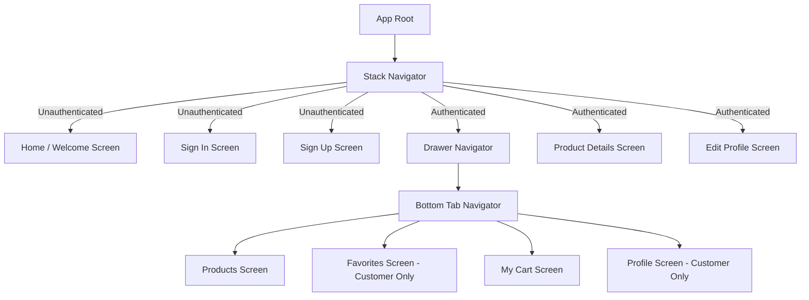

# 🛒 AS Mart – Grocery Shop Mobile App

> **Mobile Application Development using React Native (Core Elective-II)**  
> **Course:** Master of Computer Applications (MCA 2025 Batch Semester – III)  
> **Institution:** RVS College of Arts and Science (Autonomous), School of Computer Studies (SCS), Sulur, Coimbatore

---

## 📖 Project Overview

**AS Mart** is a modern, high-performance grocery shopping mobile application developed with **React Native (Expo)** and **JavaScript**. Designed around contemporary grocery and produce delivery interfaces (Figma-inspired fresh green aesthetic `#53B175` with smooth gradients), it supports role-based experiences for both **Customers** and **Store Admins**.

The app includes **full offline persistence via AsyncStorage**, multi-device responsive scaling, live cart calculation in Indian Rupees (₹), custom form validations, auto-login session restoration, and a 3-tier navigation structure (Stack, Bottom Tabs, and Drawer).

---

## ✨ Features List

### 🛍️ Customer Experience
- **Role-Based Authentication**: Seamless Sign In / Sign Up with role toggle and interactive show/hide password visibility.
- **Dynamic 2-4 Column Product Grid**: Automatically recalibrates column counts between phones (2 cols), landscape/phablets (3 cols), and tablets (4 cols).
- **Search & Categorization**: Instant search filter combined with horizontal category chips (`Fruits`, `Vegetables`, `Dairy`, `Bakery`, `Beverages`).
- **Product Details**: High-resolution imagery, ⭐ 4.8 star rating with review counts, detailed descriptions, and batch quantity selectors (`- [qty] +`).
- **Wishlist / Favorites**: One-tap heart toggle, dedicated Favorites view with single product addition and **"Add All to Cart"** batch addition.
- **Smart Shopping Cart & Checkout**: Real-time quantity adjustments, automatic item removal at quantity zero, subtotal, delivery fee calculation (**Free above ₹500, otherwise ₹40**), and checkout.
- **Order Purchase History**: Track past grocery orders with timestamps, items snapshot, delivery status badge, totals in ₹, and **"Order Again"** one-tap reordering.
- **Editable Profile**: Full customer profile with instant regex email verification and 10-digit mobile number validation.
- **Isolated User Storage**: Carts, wishlists, and order histories are isolated per user account so data is never shared between accounts.

### 🛡️ Admin Experience
- **Product Catalog Management (CRUD)**:
  - **Create**: Add new grocery products via an always-accessible, floating action button (**FAB**) pinned in the bottom-right corner.
  - **Update**: Edit existing product details in a modal sheet.
  - **Delete**: Remove items from catalog with destructive confirmation dialog.
- **Store Order History**: View all customer and store purchase orders and receipts.
- **Multi-Touchpoint Logout**: Direct Logout tab in bottom bar, styled red Logout badge in header, red Logout drawer menu item, and drawer footer button.
- **Role-Aware Security**: Restricted from Customer-only screens (Favorites, Customer Profile) while retaining full store administration.

---

## 🛠️ Tech Stack

- **Framework**: React Native (Expo SDK 58 / Expo Go)
- **Language**: JavaScript (ES6+)
- **Navigation**:
  - `@react-navigation/native` (v7)
  - `@react-navigation/native-stack` (Stack Navigator)
  - `@react-navigation/bottom-tabs` (Bottom Tab Navigator)
  - `@react-navigation/drawer` (Drawer Navigator)
- **Local Persistence**: `@react-native-async-storage/async-storage`
- **Gestures & Animations**: `react-native-gesture-handler`, `react-native-reanimated`, `react-native-screens`, `react-native-safe-area-context`
- **Icons**: `@expo/vector-icons` (Ionicons)
- **State Management**: React Context API (`AuthContext`, `ProductsContext`, `FavoritesContext`, `CartContext`)

---

## 📱 Navigation Architecture

The app incorporates all **three** core React Navigation paradigms:



1. **Stack Navigator** (`AppNavigator.js`): Controls global screen transitions, auth redirection, modal presentations, and prevents back-button access post-logout.
2. **Bottom Tab Navigator** (`BottomTabNavigator.js`): Primary in-app navigation with role filtering and live cart item count badge.
3. **Drawer Navigator** (`DrawerNavigator.js`): Side navigation menu with user avatar, role badge, navigation shortcuts, and one-tap logout.

---

## 🔐 Demo Login Credentials

The app comes preloaded with hardcoded test credentials for immediate evaluation. New accounts can also be created on the Sign Up screen:

| Role | Email Address | Password | Permissions |
| :--- | :--- | :--- | :--- |
| **Admin** | `admin@gmail.com` | `Admin@123` | Full CRUD on Catalog, Cart, Logout |
| **Customer** | `customer@gmail.com` | `Cust@123` | Browse, Wishlist, Cart, Checkout, Profile Edit |
| *Alternative* | `admin@grocery.com` | `Admin@123` | Legacy Admin test account |
| *Alternative* | `customer@grocery.com` | `Cust@123` | Legacy Customer test account |

> **📌 Security Note (Exam & Demo Notice):**  
> For this standalone college hackathon project, credentials and mock user accounts are stored locally in `AsyncStorage` in plain text without a backend server. In a production commercial application, user passwords would never be stored in plain text or kept in local storage; they would be securely processed on a dedicated backend using strong cryptographic hashing (e.g., bcrypt, Argon2) and authenticated via secure session cookies or JWT tokens.

---

## 📁 Folder Structure

```
GroceryApp/
├── App.js                          # Root application wrapper with Context Providers
├── app.json                        # Expo configuration (orientation: default)
├── index.js                        # Gesture handler root entry point
├── package.json                    # Project dependencies and run scripts
├── README.md                       # Comprehensive project documentation
├── src/
│   ├── theme.js                    # Theme export entry
│   ├── theme/
│   │   ├── colors.js               # Fresh green palette (#53B175) & UI tokens
│   │   ├── fonts.js                # Typography sizing & font weights
│   │   └── index.js
│   ├── data/
│   │   └── products.js             # 15 realistic Indian grocery products (₹)
│   ├── utils/
│   │   ├── storage.js              # AsyncStorage helpers (saveData, getData, removeData)
│   │   ├── format.js               # formatPrice (₹) with Indian Numbering System
│   │   └── responsive.js           # Responsive scaling (wp, hp, scaleFont, getGridColumns)
│   ├── context/
│   │   ├── AppContext.js           # Barrel export for all contexts & custom hooks
│   │   ├── AuthContext.js          # Authentication, auto-login & session persistence
│   │   ├── ProductsContext.js      # Product catalog state & Admin CRUD persistence
│   │   ├── FavoritesContext.js     # Per-user wishlist persistence
│   │   └── CartContext.js          # Per-user shopping cart & live total calculations
│   ├── components/
│   │   ├── CustomButton.js         # Styled primary, outline, and danger buttons
│   │   ├── CustomInput.js          # Validated text input with eye icon & inline error
│   │   ├── ProductCard.js          # Responsive product grid card with ₹ pricing
│   │   └── CartItem.js             # Cart item row with +/- controls and delete
│   ├── screens/
│   │   ├── WelcomeScreen.js        # Screen 1: App logo, banner, role toggle
│   │   ├── SignInScreen.js         # Screen 2: Email & password validation, role toggle
│   │   ├── SignUpScreen.js         # Screen 3: Registration with confirm password check
│   │   ├── ProductsScreen.js       # Screen 4: Dynamic grid, search, chips, Admin CRUD
│   │   ├── ProductDetailsScreen.js # Screen 5: Big image, ⭐ 4.8 rating, quantity picker
│   │   ├── FavoritesScreen.js      # Screen 6: Wishlist, single & batch Add All to Cart
│   │   ├── CartScreen.js           # Screen 7: Live ₹ totals, free delivery rule, checkout
│   │   ├── ProfileScreen.js        # Customer profile view with avatar and info
│   │   └── EditProfileScreen.js    # Edit profile with regex & 10-digit phone check
│   └── navigation/
│       ├── AppNavigator.js         # Stack Navigator & storage loading splash
│       ├── BottomTabNavigator.js   # Bottom Tab Navigator with cart badge
│       └── DrawerNavigator.js      # Responsive Drawer Navigator (78% screen width)
```

---

## 🚀 Installation & Running Steps

### Prerequisites
- [Node.js](https://nodejs.org/) (v18 or higher recommended)
- [Expo Go](https://expo.dev/go) installed on your mobile phone (Android / iOS)

### 1. Clone & Install Dependencies
```bash
# Clone the repository
git clone https://github.com/<your-username>/GroceryApp.git
cd GroceryApp

# Install dependencies
npm install
```

### 2. Run the Development Server
```bash
# Standard local start:
npx expo start -c

# On college/campus networks or if scanning from a different Wi-Fi, run in tunnel mode:
npx expo start --tunnel -c
```

### 3. Open on Your Device
- **Android**: Open **Expo Go** app and scan the QR code displayed in your terminal.
- **iOS**: Open the native **Camera** app and tap the Expo Go notification banner.
- **Web Browser**: Press `w` in the terminal to view in Google Chrome / Edge.

---

## 🖼️ Application Screenshots

| 1. Home / Welcome Screen | 2. Sign In (with Role Toggle) | 3. Sign Up (with Validation) |
| :---: | :---: | :---: |
|  |  |  |

| 4. Products List (2-Col Grid) | 5. Product Details Screen | 6. Wishlist / Favorites Screen |
| :---: | :---: | :---: |
|  |  |  |

| 7. Shopping Cart (Live ₹ Totals) | 8. Customer Profile View | 9. Responsive Drawer Navigation |
| :---: | :---: | :---: |
|  |  |  |

---

## ✅ Functional Requirements Checklist

| Requirement | Implementation Details | Status |
| :--- | :--- | :---: |
| **All users navigate each screen** | Every button, drawer link, and card has active working navigation. | **Complete** ✅ |
| **Add single / multiple to cart** | Direct `+` add from grid, row add from Favorites, batch **"Add All to Cart"**, and detail screen quantity selector. | **Complete** ✅ |
| **Cart item increments & decrements** | Real-time `+` / `–` adjustments; items automatically remove when quantity hits zero. | **Complete** ✅ |
| **Live Currency Totals** | Subtotal, conditional delivery fee (**Free over ₹500, otherwise ₹40**), and total format automatically via `formatPrice`. | **Complete** ✅ |
| **Storage Persistence** | AsyncStorage stores `users`, `currentUser`, `products`, and per-user `cart` & `favorites`. | **Complete** ✅ |
| **Form Validations** | Name required, email format regex, 6+ character password with number, matching confirm password, 10-digit phone. | **Complete** ✅ |
| **Logout Confirmation** | Logout alerts with Cancel/Logout options; purges `currentUser` and resets navigation stack. | **Complete** ✅ |
| **Responsive Grid & Rotation** | Dynamic columns (2 phones, 3 wide, 4 tablets), safe area insets, keyboard avoiding views. | **Complete** ✅ |

---

## 👨‍💻 Student & Course Information

- **Student Name:** Aravinth
- **Course:** Master of Computer Applications (MCA) – 2025 Batch
- **Semester:** Semester – III
- **Subject:** Core Elective-II: Mobile App Development using React Native
- **Institution:** RVS College of Arts and Science (Autonomous), Coimbatore
